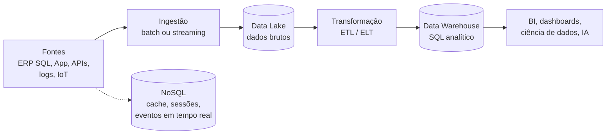

# Bancos de Dados Relacionais (SQL) e Não Relacionais (NoSQL) para Engenharia de Dados

Anotações do desafio da DIO sobre o papel dos bancos **SQL** e **NoSQL** no trabalho de um Engenheiro de Dados: conceitos, diferenças, quando usar cada um e como eles aparecem em um pipeline de dados.

## Sumário
1. [O que faz um Engenheiro de Dados](#1-o-que-faz-um-engenheiro-de-dados)
2. [Bancos de dados relacionais (SQL)](#2-bancos-de-dados-relacionais-sql)
3. [Bancos de dados não relacionais (NoSQL)](#3-bancos-de-dados-não-relacionais-nosql)
4. [SQL x NoSQL: comparação](#4-sql-x-nosql-comparação)
5. [ACID, BASE e Teorema CAP](#5-acid-base-e-teorema-cap)
6. [Escalabilidade: vertical x horizontal](#6-escalabilidade-vertical-x-horizontal)
7. [OLTP x OLAP](#7-oltp-x-olap)
8. [Onde cada banco entra no pipeline de dados](#8-onde-cada-banco-entra-no-pipeline-de-dados)
9. [Data Warehouse, Data Lake e Lakehouse](#9-data-warehouse-data-lake-e-lakehouse)
10. [Como escolher](#10-como-escolher)
11. [Glossário](#11-glossário)
12. [Meus insights](#12-meus-insights)

---

## 1. O que faz um Engenheiro de Dados

O Engenheiro de Dados constrói e mantém a **infraestrutura** que leva o dado da origem até quem vai usá-lo (analistas, cientistas de dados, sistemas e dashboards). O trabalho dele inclui:

- **Coletar (ingestão):** buscar dados de sistemas, APIs, arquivos, logs e sensores.
- **Transformar:** limpar, padronizar, juntar e agregar os dados.
- **Armazenar:** escolher **o banco certo para cada tipo de dado e de uso**.
- **Disponibilizar:** entregar dados confiáveis, atualizados e com bom desempenho.
- **Garantir qualidade e governança:** cuidar de segurança, privacidade (LGPD), documentação e monitoramento.

Por isso ele precisa conhecer **SQL e NoSQL**: cada tipo de banco resolve um problema diferente, e em uma empresa real os dois convivem.

---

## 2. Bancos de dados relacionais (SQL)

Organizam os dados em **tabelas** (linhas e colunas) que se relacionam por meio de **chaves**. O modelo foi proposto por Edgar F. Codd em 1970, e a linguagem usada para consultar e manipular os dados é o **SQL** (*Structured Query Language*).

### Conceitos principais
| Conceito | Definição |
| --- | --- |
| **Tabela (relação)** | Conjunto de dados organizado em linhas e colunas |
| **Linha (tupla / registro)** | Uma ocorrência, por exemplo um cliente |
| **Coluna (atributo)** | Uma característica, por exemplo o CPF |
| **Chave primária (PK)** | Identifica cada linha de forma única |
| **Chave estrangeira (FK)** | Liga uma tabela a outra, garantindo integridade referencial |
| **Constraints** | Regras como `NOT NULL`, `UNIQUE`, `CHECK`, `DEFAULT` |
| **Schema** | Estrutura definida **antes** de inserir os dados (*schema-on-write*) |
| **Normalização** | Organização das tabelas para evitar redundância e anomalias (1FN, 2FN, 3FN) |
| **Índice** | Estrutura que acelera buscas, como o índice de um livro |
| **Transação** | Conjunto de operações que acontece por inteiro ou não acontece |
| **View** | Consulta salva que funciona como uma tabela virtual |

### Subconjuntos da linguagem SQL
| Sigla | Nome | Comandos |
| --- | --- | --- |
| DDL | Data Definition Language | `CREATE`, `ALTER`, `DROP`, `TRUNCATE` |
| DML | Data Manipulation Language | `INSERT`, `UPDATE`, `DELETE` |
| DQL | Data Query Language | `SELECT` |
| DCL | Data Control Language | `GRANT`, `REVOKE` |
| TCL | Transaction Control Language | `COMMIT`, `ROLLBACK`, `SAVEPOINT` |

### Exemplo
```sql
SELECT c.nome, COUNT(p.idPedido) AS totalPedidos
FROM cliente c
LEFT JOIN pedido p ON p.idCliente = c.idCliente
GROUP BY c.nome
HAVING COUNT(p.idPedido) > 1
ORDER BY totalPedidos DESC;
```

### Exemplos de SGBDs relacionais
MySQL, PostgreSQL, SQL Server, Oracle, MariaDB, SQLite.
Na nuvem: Amazon RDS / Aurora, Azure SQL Database, Google Cloud SQL.

### Pontos fortes
- Integridade e consistência dos dados (transações ACID).
- Linguagem padronizada e muito conhecida.
- Ótimo para relacionamentos complexos e consultas com `JOIN`.
- Tecnologia madura, com muitas ferramentas, documentação e profissionais no mercado.

### Limitações
- O schema rígido dificulta mudanças rápidas na estrutura.
- A escala horizontal é mais difícil (geralmente o crescimento é vertical).
- Não é ideal para dados sem estrutura fixa (JSON muito variado, textos, mídias).

---

## 3. Bancos de dados não relacionais (NoSQL)

**NoSQL** significa *"Not Only SQL"*. São bancos que **não usam o modelo de tabelas relacionadas** como estrutura principal. Surgiram com a internet em grande escala (redes sociais, e-commerce, IoT), que exigia muito volume, muita velocidade e flexibilidade no formato dos dados.

Características comuns:
- **Schema flexível** (*schema-on-read*): cada registro pode ter campos diferentes.
- **Escala horizontal:** distribuem os dados entre vários servidores (*sharding*).
- **Alta disponibilidade:** replicam os dados entre nós.
- Em geral priorizam **disponibilidade e desempenho**, aceitando **consistência eventual**.

### Os 4 principais tipos

| Tipo | Como guarda os dados | Exemplos | Casos de uso |
| --- | --- | --- | --- |
| **Documento** | Documentos JSON/BSON com estrutura flexível | MongoDB, Couchbase, Firestore | Catálogo de produtos, perfis de usuário, conteúdo de apps |
| **Chave-valor** | Pares `chave → valor`, como um dicionário | Redis, DynamoDB, Memcached | Cache, sessão de login, carrinho de compras, filas |
| **Colunar (família de colunas)** | Linhas com colunas dinâmicas agrupadas em famílias | Cassandra, HBase, ScyllaDB | Séries temporais, IoT, logs, grandes volumes de escrita |
| **Grafo** | Nós (entidades) e arestas (relacionamentos) | Neo4j, Amazon Neptune | Redes sociais, recomendação, detecção de fraude, rotas |

> Também existem bancos de **séries temporais** (InfluxDB, TimescaleDB), de **busca** (Elasticsearch) e **vetoriais** (usados em IA para buscar por similaridade).

### Exemplo: o mesmo pedido em um banco de documentos (MongoDB)
```json
{
  "_id": "pedido_1001",
  "cliente": { "nome": "Maria Silva", "cpf": "11122233344" },
  "itens": [
    { "produto": "Notebook 15\"", "quantidade": 1, "valor": 3899.90 },
    { "produto": "Mouse sem fio", "quantidade": 1, "valor": 79.90 }
  ],
  "pagamentos": [
    { "tipo": "Cartão", "valor": 3000.00 },
    { "tipo": "Pix", "valor": 1004.80 }
  ],
  "entrega": { "status": "Entregue", "codigoRastreio": "BR100000001SP" }
}
```
No modelo relacional esse pedido estaria dividido em **6 tabelas** (cliente, pedido, pedido_produto, produto, pedido_pagamento, entrega). No documento fica **tudo junto**: a leitura é mais rápida, mas os dados ficam duplicados (o nome do cliente, por exemplo, se repete em cada pedido).

```js
// Consulta equivalente no MongoDB
db.pedidos.find({ "entrega.status": "Entregue" }, { "cliente.nome": 1, itens: 1 })
```

---

## 4. SQL x NoSQL: comparação

| Critério | SQL (relacional) | NoSQL (não relacional) |
| --- | --- | --- |
| Estrutura | Tabelas com schema fixo | Documentos, chave-valor, colunas ou grafos |
| Schema | Rígido, definido antes (*schema-on-write*) | Flexível (*schema-on-read*) |
| Relacionamentos | Fortes, com FK e `JOIN` | Fracos ou embutidos (desnormalização) |
| Consistência | Forte (ACID) | Geralmente eventual (BASE), varia por banco |
| Escalabilidade | Principalmente vertical | Principalmente horizontal |
| Linguagem | SQL padronizado | Própria de cada banco (APIs, MQL, CQL, Cypher) |
| Ponto forte | Integridade, consultas complexas, transações | Volume, velocidade, flexibilidade e disponibilidade |
| Bom para | Sistemas financeiros, ERP, pedidos, estoque | Big data, tempo real, IoT, cache, catálogos, redes |

> **Importante:** não existe "melhor". Existe o banco **mais adequado ao problema**. A fronteira também está diminuindo: o PostgreSQL tem o tipo `JSONB` para documentos, e o MongoDB passou a suportar transações ACID.

---

## 5. ACID, BASE e Teorema CAP

### ACID (bancos relacionais)
| Letra | Propriedade | Significado |
| --- | --- | --- |
| **A** | Atomicidade | A transação acontece **inteira ou não acontece** |
| **C** | Consistência | O banco sai de um estado válido para outro estado válido, respeitando as regras |
| **I** | Isolamento | Transações simultâneas não interferem uma na outra |
| **D** | Durabilidade | Depois do `COMMIT`, o dado não se perde, mesmo se o servidor cair |

Exemplo clássico: em uma transferência bancária, debitar de uma conta e creditar na outra precisa acontecer **junto**. Se uma das partes falhar, as duas são desfeitas (`ROLLBACK`).

### BASE (muitos bancos NoSQL)
- **B**asically **A**vailable: o sistema está sempre disponível.
- **S**oft state: o estado pode mudar com o tempo, mesmo sem novas entradas, por causa da replicação.
- **E**ventual consistency: com o tempo, todas as réplicas ficam iguais.

Exemplo: o número de curtidas de uma postagem pode aparecer diferente para duas pessoas por alguns segundos, e isso não é um problema.

### Teorema CAP
Em um sistema **distribuído**, quando acontece uma falha de rede (**P**artição), o sistema precisa escolher entre:
- **C**onsistência: todos leem o mesmo dado atualizado.
- **A**disponibilidade (*Availability*): todo pedido recebe resposta.

| Escolha | Comportamento | Exemplos |
| --- | --- | --- |
| **CP** | Prefere responder com erro a responder um dado desatualizado | MongoDB (configuração padrão), HBase |
| **AP** | Sempre responde, mesmo que o dado esteja temporariamente desatualizado | Cassandra, DynamoDB, CouchDB |

---

## 6. Escalabilidade: vertical x horizontal

| | Vertical (*scale up*) | Horizontal (*scale out*) |
| --- | --- | --- |
| Como | Servidor mais potente (mais CPU, RAM, disco) | Mais servidores dividindo a carga |
| Limite | Tem teto físico e custo alto | Cresce "sem limite" adicionando nós |
| Típico de | Bancos relacionais tradicionais | Bancos NoSQL |

Técnicas importantes:
- **Replicação:** cópias dos dados em vários servidores, para disponibilidade e leitura.
- **Sharding (particionamento):** divide os dados entre servidores, por exemplo clientes de A a M no servidor 1 e de N a Z no servidor 2.

---

## 7. OLTP x OLAP

| | OLTP (transacional) | OLAP (analítico) |
| --- | --- | --- |
| Objetivo | Operar o negócio no dia a dia | Analisar o negócio e tomar decisões |
| Operações | Muitos `INSERT`/`UPDATE` pequenos e rápidos | Poucos `SELECT` grandes, com agregações |
| Exemplo | Registrar um pedido, dar baixa no estoque | Faturamento por região nos últimos 3 anos |
| Modelagem | Normalizada (3FN) | Desnormalizada (modelo estrela / floco de neve) |
| Bancos | MySQL, PostgreSQL, SQL Server, ERP | Data Warehouse: BigQuery, Redshift, Snowflake, Synapse |

O Engenheiro de Dados normalmente **leva os dados do OLTP para o OLAP** sem sobrecarregar o sistema que opera o negócio.

---

## 8. Onde cada banco entra no pipeline de dados



- **Na origem:** sistemas transacionais (ERP, e-commerce) usam **SQL**. Apps, sensores e logs muitas vezes usam **NoSQL**.
- **Na ingestão e no armazenamento bruto:** **Data Lake** (arquivos em Parquet, JSON, CSV) e bancos NoSQL para grandes volumes.
- **Na camada analítica:** **Data Warehouse**, consultado com **SQL**.
- **Na entrega em tempo real:** NoSQL como **Redis** (cache) ou **Cassandra** (leituras rápidas em escala).

### ETL x ELT
| | ETL | ELT |
| --- | --- | --- |
| Ordem | Extrai → **Transforma** → Carrega | Extrai → Carrega → **Transforma** |
| Onde transforma | Em uma ferramenta intermediária | Dentro do próprio Data Warehouse, com SQL |
| Mais comum em | Ambientes tradicionais | Nuvem moderna (BigQuery, Snowflake, dbt) |

> Mesmo com tanto NoSQL e Big Data, **SQL continua sendo a habilidade mais usada por quem trabalha com dados**. Spark SQL, BigQuery, Athena e dbt são todos baseados em SQL.

---

## 9. Data Warehouse, Data Lake e Lakehouse

| | Data Warehouse | Data Lake | Lakehouse |
| --- | --- | --- | --- |
| Dados | Estruturados e tratados | Qualquer formato, inclusive brutos | Qualquer formato, com organização de tabela |
| Schema | *On-write* | *On-read* | Os dois |
| Uso | BI e relatórios | Big data, ciência de dados, histórico bruto | BI e ciência de dados no mesmo lugar |
| Exemplos | BigQuery, Redshift, Snowflake | Amazon S3, Azure Data Lake, Google Cloud Storage | Databricks (Delta Lake), Apache Iceberg |

Uma organização comum em camadas é a **Arquitetura Medalhão**:
- **Bronze:** dado bruto, como chegou.
- **Prata:** dado limpo e padronizado.
- **Ouro:** dado agregado e pronto para o negócio.

---

## 10. Como escolher

Perguntas que ajudam na decisão:

1. **Os dados têm estrutura fixa e relacionamentos importantes?** → SQL
2. **Preciso de transações garantidas (dinheiro, estoque, notas fiscais)?** → SQL
3. **A estrutura muda muito ou cada registro é diferente?** → NoSQL de documento
4. **Preciso de respostas em milissegundos para dados simples (cache, sessão)?** → NoSQL chave-valor
5. **Volume enorme de escrita, como sensores e logs?** → NoSQL colunar
6. **O valor está nas conexões entre os dados (amigos, recomendações, fraude)?** → NoSQL de grafo
7. **Preciso analisar grandes volumes históricos?** → Data Warehouse (SQL analítico)

### Persistência poliglota
Em projetos reais é comum usar **vários bancos ao mesmo tempo**, cada um no que faz de melhor. Exemplo de um e-commerce:

| Necessidade | Banco |
| --- | --- |
| Pedidos, pagamentos e estoque | PostgreSQL / MySQL (SQL) |
| Catálogo de produtos com atributos variados | MongoDB (documento) |
| Carrinho e sessão do usuário | Redis (chave-valor) |
| "Quem comprou isso também comprou" | Neo4j (grafo) |
| Busca de produtos por texto | Elasticsearch |
| Relatórios de vendas | BigQuery / Snowflake (Data Warehouse) |

---

## 11. Glossário

| Termo | Significado |
| --- | --- |
| **SGBD** | Sistema Gerenciador de Banco de Dados |
| **Schema-on-write** | A estrutura é validada na gravação (SQL) |
| **Schema-on-read** | A estrutura é interpretada na leitura (NoSQL, Data Lake) |
| **Normalização** | Divisão em tabelas para evitar redundância |
| **Desnormalização** | Juntar dados duplicando informações, para ganhar velocidade na leitura |
| **Sharding** | Dividir os dados entre vários servidores |
| **Replicação** | Manter cópias dos dados em vários servidores |
| **Consistência eventual** | As réplicas ficam iguais depois de algum tempo |
| **Batch** | Processamento em lotes, por exemplo uma vez por dia |
| **Streaming** | Processamento contínuo, em tempo (quase) real |
| **Pipeline de dados** | Fluxo automatizado que leva o dado da origem ao destino |
| **Parquet** | Formato de arquivo colunar muito usado em Data Lakes |
| **3 Vs do Big Data** | Volume, Velocidade e Variedade (às vezes também Veracidade e Valor) |

---

## 12. Meus insights

- **SQL não é "antigo" e NoSQL não é "moderno".** São ferramentas para problemas diferentes, e as empresas usam as duas.
- **SQL é a base de tudo:** aparece no banco transacional, no Data Warehouse, no Spark e no dbt. Vale muito a pena dominar `JOIN`, `GROUP BY`, `HAVING` e as funções de janela.
- **Modelar bem vem antes de escolher o banco.** Nos meus projetos de modelagem (e-commerce e oficina), entender as entidades e os relacionamentos foi o que permitiu criar as tabelas, as chaves e as consultas.
- **Integridade x flexibilidade é a troca central:** SQL protege o dado com regras (PK, FK, CHECK), enquanto NoSQL abre mão de parte dessas garantias para ganhar escala e velocidade.
- **No mundo de ERP** (como TOTVS Protheus, que estou estudando), a base é **relacional**: tabelas, índices e consultas SQL no SQL Server ou Oracle. Por isso SQL é o primeiro passo da minha trilha.

### Meus projetos relacionados
- [Projeto conceitual – E-commerce](https://github.com/Leandrolfq/projeto-conceitual-ecommerce)
- [Projeto conceitual – Oficina mecânica](https://github.com/Leandrolfq/projeto-conceitual-oficina)
- [Projeto lógico – E-commerce (SQL)](https://github.com/Leandrolfq/projeto-logico-ecommerce)
- [Projeto lógico – Oficina mecânica (SQL)](https://github.com/Leandrolfq/projeto-logico-oficina)

---

## Referências
- Documentação do [MySQL](https://dev.mysql.com/doc/) e do [PostgreSQL](https://www.postgresql.org/docs/)
- Documentação do [MongoDB](https://www.mongodb.com/docs/), do [Redis](https://redis.io/docs/), do [Cassandra](https://cassandra.apache.org/doc/) e do [Neo4j](https://neo4j.com/docs/)
- Aulas da trilha de Banco de Dados da DIO
